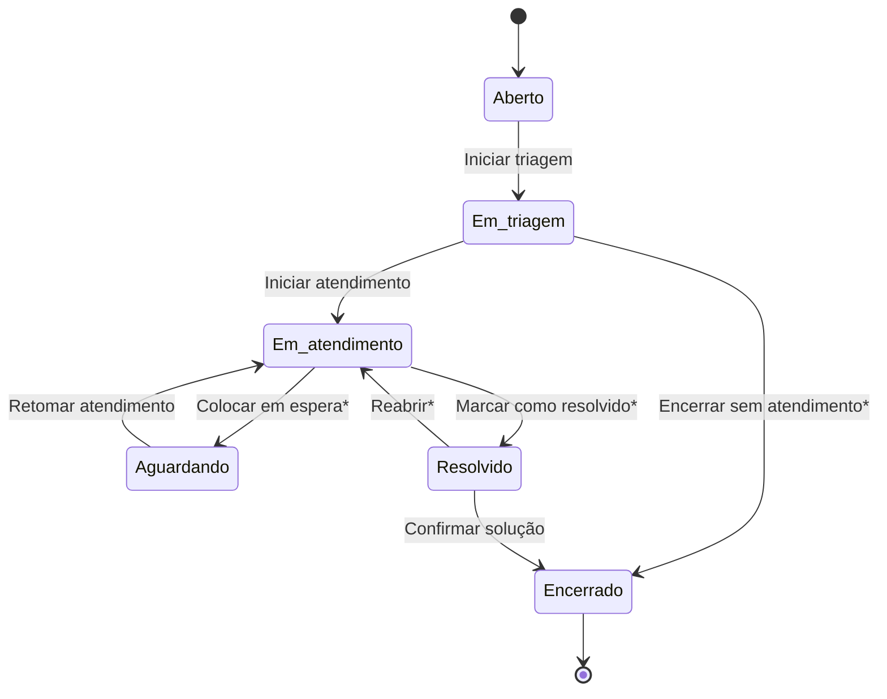
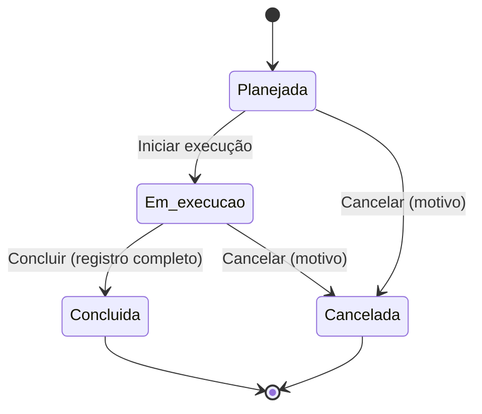

# 00 — Especificação de requisitos

Documento de referência do **Sistema de Chamados e Ordens de Manutenção**. É a base para a análise,
a rastreabilidade e os casos de teste da SA 1, e para os critérios de validação das SAs 2 e 3.

- Cada requisito tem um **identificador** (ex.: `RF-08`, `RN-CH-02`). Use-o na matriz de rastreabilidade,
  nos casos de teste e nos registros de falha.
- "Equipe" significa usuários com papel **Técnico** ou **Administrador**.
- Os nomes de estados e campos são os mesmos da tela.

## 1. Contexto

Um setor de manutenção fictício atende equipamentos de uma escola técnica fictícia. Qualquer pessoa
cadastrada pode **abrir um chamado** quando um equipamento apresenta problema. A **equipe técnica** faz a
triagem, atribui um responsável, cria **ordens de manutenção** para executar o serviço e registra o que foi
feito. O solicitante acompanha o andamento e confirma a solução.

### Papéis

| Papel | Quem é | Resumo do que pode fazer |
| --- | --- | --- |
| Solicitante | Qualquer pessoa cadastrada (papel inicial) | Abre chamados e acompanha **os próprios** chamados; confirma ou reabre quando resolvidos. |
| Técnico | Equipe de manutenção | Vê todos os chamados; faz triagem; cria e executa ordens; cadastra e edita equipamentos. |
| Administrador | Responsável pelo sistema | Tudo do técnico, mais: altera papéis de usuários e exclui equipamentos sem chamados. |

## 2. Requisitos funcionais (RF)

| ID | Requisito | Quem |
| --- | --- | --- |
| RF-01 | Cadastrar-se com nome, e-mail e senha (mínimo 8 caracteres, com confirmação). O acesso só é liberado após **confirmar o e-mail** pelo link recebido. | Visitante |
| RF-02 | Entrar com e-mail e senha e sair do sistema. Telas internas exigem login. | Todos |
| RF-03 | Alterar o papel de qualquer usuário (Solicitante, Técnico, Administrador). | Administrador |
| RF-04 | Listar equipamentos, buscar por código, nome ou localização e filtrar por categoria e estado. | Todos |
| RF-05 | Cadastrar e editar equipamentos (código, nome, categoria, localização, descrição, estado). | Equipe |
| RF-06 | Ver os detalhes de um equipamento, seus chamados e seu histórico. | Todos |
| RF-07 | Excluir um equipamento. | Administrador |
| RF-08 | Abrir chamado para um equipamento, informando título, descrição, categoria e prioridade sugerida. | Todos |
| RF-09 | Listar chamados e filtrar por status, prioridade, equipamento e período de abertura. | Todos (solicitante vê só os seus) |
| RF-10 | Fazer a triagem do chamado: ajustar prioridade e categoria e atribuir o técnico responsável. | Equipe |
| RF-11 | Mudar o status do chamado seguindo as transições permitidas, com observação quando exigida. | Equipe; solicitante em casos específicos |
| RF-12 | Registrar comentários no chamado: **internos** (só equipe) ou **públicos** (visíveis ao solicitante). | Todos (solicitante só públicos) |
| RF-13 | Ver o histórico cronológico do chamado (quem fez o quê e quando). | Todos (com restrições, ver RN-AC-01) |
| RF-14 | Criar ordem de manutenção a partir de um chamado, com tipo, responsável, diagnóstico inicial e plano de ação. | Equipe |
| RF-15 | Registrar na ordem: tipo, responsável, diagnóstico, plano de ação, atividades executadas e resultado. | Equipe |
| RF-16 | Mudar o status da ordem seguindo as transições permitidas. | Equipe |
| RF-17 | Listar ordens e filtrar por status e tipo. | Equipe |
| RF-18 | Ver painel com totais de equipamentos, chamados por status e prioridade e ordens em andamento. | Todos |
| RF-19 | Consultar o teste de fumaça `/api/saude`, que informa se aplicação e banco estão respondendo. | Qualquer pessoa |
| RF-20 | Exportar em CSV (para planilha) a lista de chamados com os filtros aplicados, respeitando o que cada usuário pode ver. | Todos (solicitante só os seus) |

## 3. Regras de negócio (RN)

### Equipamentos

| ID | Regra |
| --- | --- |
| RN-EQ-01 | O **código patrimonial** é obrigatório, **único** e segue o formato `AAA-0000` (3 letras, hífen, 4 números). Letras minúsculas são convertidas para maiúsculas. |
| RN-EQ-02 | Nome (3 a 120 caracteres), categoria, localização (2 a 120) e estado operacional são obrigatórios. Descrição é opcional (até 1000). |
| RN-EQ-03 | Estados operacionais: **Disponível**, **Em manutenção**, **Inativo**. Equipamento **inativo não aceita novos chamados**. |
| RN-EQ-04 | Equipamento que possui chamados **não pode ser excluído**; para retirá-lo de uso, altere o estado para Inativo. |

### Chamados

| ID | Regra |
| --- | --- |
| RN-CH-01 | O chamado só muda de status pelas transições da tabela 3.1. Qualquer outra é recusada. |
| RN-CH-02 | Na abertura: equipamento obrigatório; **título** de 5 a 120 caracteres; **descrição** com no mínimo **10 caracteres, sem contar espaços no início e no fim**, e no máximo 2000; categoria e prioridade obrigatórias. O chamado nasce **Aberto**, sem técnico, em nome de quem está logado. |
| RN-CH-03 | **Observação obrigatória** ao: encerrar sem atendimento, colocar em espera (Aguardando), marcar como Resolvido e reabrir. A observação aparece no histórico. |
| RN-CH-04 | Para ir para **Em atendimento** é preciso ter um **técnico responsável** atribuído, e ele precisa ter papel Técnico ou Administrador. |
| RN-CH-05 | O chamado não pode ser marcado como **Resolvido** enquanto houver ordem de manutenção **ativa** (Planejada ou Em execução). |
| RN-CH-06 | Chamado **Encerrado** não pode ser alterado nem receber comentários. |
| RN-CH-07 | Título, descrição, solicitante e data de abertura não mudam depois da abertura. |
| RN-CH-08 | O solicitante só pode, no **próprio** chamado **Resolvido**, confirmar a solução (Encerrado) ou reabrir (Em atendimento). |

#### 3.1 Transições de status do chamado

| De | Para | Ação na tela | Quem | Observação |
| --- | --- | --- | --- | --- |
| Aberto | Em triagem | Iniciar triagem | Equipe | — |
| Em triagem | Em atendimento | Iniciar atendimento | Equipe | — (exige técnico, RN-CH-04) |
| Em triagem | Encerrado | Encerrar sem atendimento | Equipe | Obrigatória |
| Em atendimento | Aguardando | Colocar em espera | Equipe | Obrigatória |
| Em atendimento | Resolvido | Marcar como resolvido | Equipe | Obrigatória (RN-CH-05) |
| Aguardando | Em atendimento | Retomar atendimento | Equipe | — |
| Resolvido | Encerrado | Confirmar solução e encerrar | Equipe ou solicitante do chamado | — |
| Resolvido | Em atendimento | Reabrir chamado | Equipe ou solicitante do chamado | Obrigatória |

`*` = exige observação.

### Ordens de manutenção

| ID | Regra |
| --- | --- |
| RN-OM-01 | A ordem só muda de status pelas transições da tabela 3.2. **Concluída** e **Cancelada** são finais. |
| RN-OM-02 | A ordem é criada a partir de um chamado **Em triagem, Em atendimento ou Aguardando**. Cada chamado pode ter **no máximo uma ordem ativa** (Planejada ou Em execução). O equipamento da ordem é sempre o do chamado. O responsável deve ser Técnico ou Administrador. |
| RN-OM-03 | Para **concluir**: diagnóstico, atividades executadas e resultado preenchidos. As datas de **início** (ao entrar em execução) e **conclusão** são registradas automaticamente. |
| RN-OM-04 | Quando a ordem entra **Em execução**, o equipamento passa para **Em manutenção**. Quando a última ordem em execução do equipamento é **concluída ou cancelada**, ele volta a **Disponível**. |
| RN-OM-05 | **Cancelar** exige informar o motivo. |
| RN-OM-06 | Ordem concluída ou cancelada **não pode ser alterada** (o registro é preservado). O **tipo** de manutenção só pode mudar enquanto a ordem está Planejada. |

#### 3.2 Transições de status da ordem

| De | Para | Ação na tela | Condição |
| --- | --- | --- | --- |
| Planejada | Em execução | Iniciar execução | — |
| Planejada | Cancelada | Cancelar ordem | Motivo obrigatório |
| Em execução | Concluída | Concluir ordem | RN-OM-03 |
| Em execução | Cancelada | Cancelar ordem | Motivo obrigatório |

**Tipos de manutenção:** **Corretiva** (corrige falha ocorrida), **Preventiva** (revisão programada para
evitar falhas), **Evolutiva** (melhoria ou adaptação a uma nova necessidade).
**Resultados:** Resolvido, Parcial, Não resolvido.

### Acesso e auditoria

| ID | Regra |
| --- | --- |
| RN-AC-01 | O **solicitante** vê somente: os próprios chamados, as ordens desses chamados, os comentários **públicos** deles e os eventos de histórico marcados como visíveis. |
| RN-AC-02 | A **equipe** vê todos os chamados, ordens, comentários e eventos. Só a equipe cadastra/edita equipamentos, faz triagem e cria/altera ordens. |
| RN-AC-03 | Toda conta nova começa como **Solicitante**, mesmo que o cadastro tente enviar outro papel. Só o administrador altera papéis, e o sistema impede remover o **último administrador**. |
| RN-AC-04 | Sem login, nenhuma informação das tabelas é acessível (apenas o teste de fumaça). |
| RN-AU-01 | O **histórico** registra automaticamente, com data/hora e autor: abertura, mudanças de status (com observação), atribuição, triagem, comentários (sem o texto), criação e mudanças das ordens e mudanças nos equipamentos. O histórico **não pode ser alterado nem apagado** por usuários. |

## 4. Requisitos não funcionais (RNF)

| ID | Requisito |
| --- | --- |
| RNF-01 | Interface em português do Brasil; datas `dd/mm/aaaa` e horários no fuso de Brasília. |
| RNF-02 | Acessibilidade: todo campo tem rótulo; navegação por teclado; foco visível; status informados por **texto e ícone**, não só por cor; mensagens de erro anunciadas a leitores de tela. |
| RNF-03 | Interface responsiva: utilizável em celular (≥ 360 px) e computador. |
| RNF-04 | Segurança: autorização verificada no servidor e reforçada no banco (RLS); nenhuma chave secreta no navegador; dados pessoais mínimos (nome e papel; e-mail só no módulo de autenticação). |
| RNF-05 | Retorno ao usuário: mensagens de carregamento, lista vazia, erro e sucesso. |
| RNF-06 | Reprodutibilidade: o ambiente local é recriado a partir das migrações e do seed (`npm run db:reset`). |
| RNF-07 | Qualidade: lint, verificação de tipos, testes automatizados e build executados na integração contínua. |

## 5. Dados iniciais (seed)

Após `npm run db:reset`: 6 usuários (1 administrador, 2 técnicos, 3 solicitantes — tabela no README),
13 equipamentos (1 inativo: `LAB-0002`; 2 em manutenção: `CLI-0001` e `MEC-0002`), 14 chamados em
todos os status e 10 ordens (planejadas, em execução, concluídas e uma cancelada).
