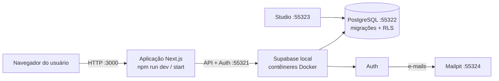

# 03 — Guia da SA 2: Liberação controlada (Implantação de Sistemas)

**Período:** encontros 9 a 12 — 21/10 a 28/10/2026 · **Estratégia:** projeto

## Desafio

Planejar e realizar uma **implantação controlada** do Sistema de Chamados de Manutenção. A equipe deve
definir método e cronograma, identificar e validar a infraestrutura, configurar serviços e segurança,
avaliar a necessidade de migração de dados, instalar e parametrizar o sistema, verificar integração e
funcionamento e organizar os registros e orientações aos usuários.

## Capacidades trabalhadas

- Identificar métodos para implantação.
- Definir cronograma de implantação do sistema.
- Identificar infraestrutura computacional necessária para implantação do sistema.
- Aplicar configurações dos serviços e segurança para instalação de sistema de acordo com os requisitos.
- Avaliar necessidade de migração de dados entre sistemas.
- Instalar sistema computacional desenvolvido de acordo com o procedimento estabelecido.
- Validar a infraestrutura computacional para implantação.
- Identificar parâmetros a serem configurados de acordo com o sistema.
- Socioemocionais: princípios da qualidade; tomada de decisão; crescimento profissional.

## Cronograma

| Enc. | Data | Atividade com o sistema | Evidência / entrega |
| --- | --- | --- | --- |
| 9 | 21/10 | Planejamento: método, etapas, cronograma, infraestrutura e **plano de retorno**. | Plano de implantação. |
| 10 | 26/10 | Infraestrutura, dependências, serviços, segurança e instalação em ambiente limpo. **AA1** (30%) e **avaliação objetiva**. | Checklist e registro de instalação. |
| 11 | 27/10 | Avaliação da migração, backup, parametrização, integração e validação. **AA2** (60%). | Roteiro de migração e validação. |
| 12 | 28/10 | Manual/orientação, entrega controlada e simulação de liberação. **Avaliação prática.** | Termo de validação e manual breve. |

## Arquitetura a implantar



| Componente | Função | Onde é configurado |
| --- | --- | --- |
| Node.js 24 + dependências npm | Executa a aplicação e as ferramentas | `.nvmrc`, `package.json`, `package-lock.json` |
| Docker | Executa os serviços do Supabase | Docker Desktop / Engine |
| Supabase local (CLI) | Banco, autenticação, Studio, e-mail local | `supabase/config.toml` |
| Esquema e regras do banco | Tabelas, gatilhos, RLS | `supabase/migrations/*.sql` |
| Dados iniciais | Usuários e registros fictícios | `supabase/seed.sql` |
| Aplicação web | Telas e regras de servidor | `app/`, `lib/`, `.env.local` |

## Roteiro

### 1. Planejamento (enc. 9)

1. **Método**: compare ao menos dois (ex.: implantação direta em ambiente novo, piloto com um grupo,
   paralela com o processo anterior em papel). Justifique a escolha para este cenário.
2. **Etapas e cronograma**: pré-requisitos → instalação → configuração → banco → validação → liberação →
   orientação. Estime tempo e responsável por etapa.
3. **Infraestrutura**: liste hardware, sistema operacional, softwares e versões, portas e rede
   (README, seções 1 e 6). Identifique riscos (ex.: pouca RAM, porta ocupada, sem internet no laboratório).
4. **Plano de retorno (rollback)**: o que fazer se a implantação falhar em cada etapa (seção 6 abaixo).

### 2. Instalação em ambiente limpo (enc. 10)

Siga o [Guia de implantação local](05-implantacao-local.md) do zero, preenchendo o
[checklist de implantação](08-modelos/checklist-implantacao.md) **enquanto executa**. Registre versões
(`node --version`, `docker --version`, `npx supabase --version`), o commit instalado (`git log -1 --oneline`)
e o tempo de cada etapa.

### 3. Serviços, segurança e parâmetros (enc. 10 e 11)

| Parâmetro | Onde | Valor local | Observação de segurança |
| --- | --- | --- | --- |
| `NEXT_PUBLIC_SUPABASE_URL` | `.env.local` | `http://127.0.0.1:55321` | Pública por natureza. |
| `NEXT_PUBLIC_SUPABASE_PUBLISHABLE_KEY` | `.env.local` | `sb_publishable_...` (via `npx supabase status -o env`) | Pode ir ao navegador; o acesso é limitado pelo RLS. |
| Chave secreta (`SECRET_KEY` / `service_role`) | não usada pela aplicação | — | **Nunca** em `.env.local` nem em `NEXT_PUBLIC_*`; ignora o RLS. |
| Portas (API, banco, Studio, e-mail) | `supabase/config.toml` | 55321, 55322, 55323, 55324 | Serviços locais, acessados por `127.0.0.1`. |
| `auth.site_url` | `supabase/config.toml` | `http://localhost:3000` | Base dos links de e-mail. |
| `auth.email.enable_confirmations` | `supabase/config.toml` | `true` | Exige confirmar e-mail antes do login. |
| `auth.minimum_password_length` | `supabase/config.toml` | 6 (a aplicação exige 8) | Regra aplicada em duas camadas. |
| `.env.local` no Git | `.gitignore` | ignorado | Verifique com `git check-ignore -v .env.local`. |

Verificações de segurança sugeridas: entrar como solicitante e tentar abrir `/usuarios` e `/ordens`;
confirmar no Studio, na área de *Policies*, que cada tabela tem RLS ativo e políticas listadas; confirmar que
`npm run db:test` passa (inclui testes de permissão).

### 4. Migração de dados (enc. 11)

**Avalie e registre**: existe sistema anterior? Que dados precisariam ser levados (equipamentos, chamados
abertos)? Em que formato? Como validar a carga? Neste projeto:

- O **esquema** é criado pelas **migrações** versionadas (`supabase/migrations/`), aplicadas em ordem.
  Ver: `npx supabase migration list --local`.
- Os **dados iniciais** vêm do **seed** (`supabase/seed.sql`), que simula uma carga inicial.
- Mudanças futuras de esquema chegam como **novas migrações** e são aplicadas sem apagar dados
  (`npm run setup:local` executa `supabase migration up`).

**Backup e restauração** (pratique antes de precisar):

```bash
# 1. Backup somente dos dados (a pasta backups/ não é versionada)
npx supabase db dump --local --data-only -f backups/dados.sql

# 2. Restauração: recria o esquema SEM o seed...
npx supabase db reset --no-seed
# ...copia o arquivo para dentro do contêiner do banco e o executa
docker cp backups/dados.sql supabase_db_sistema-chamados-manutencao:dados.sql
docker exec supabase_db_sistema-chamados-manutencao psql -U postgres -d postgres -v ON_ERROR_STOP=1 -q -f dados.sql
```

Os comandos funcionam igual no PowerShell, no Git Bash e no terminal do macOS/Linux (testados).
O backup contém dados de usuários (fictícios, com senhas criptografadas): não o publique nem o versione.

Valide a migração/restauração comparando contagens antes e depois (Studio ou painel) e rodando `npm run db:test`.

### 5. Integração e validação (enc. 11 e 12)

**Testes de fumaça** (rápidos, logo após instalar):

| # | Verificação | Esperado |
| --- | --- | --- |
| F1 | `npm run db:status` | Serviços de pé; endereços 553xx. |
| F2 | <http://localhost:3000/api/saude> | `"aplicacao":"ok"` e `"banco":"ok"`. |
| F3 | Entrar como `tecnico1@example.com` | Painel com os totais do seed. |
| F4 | Entrar como `solicitante1@example.com` | Vê só os próprios chamados. |
| F5 | Cadastrar conta nova e confirmar pelo Mailpit | Entra como Solicitante. |
| F6 | Abrir um chamado e vê-lo no histórico | Evento "Chamado aberto ..." registrado. |

**Validação completa**: `npm run lint`, `npm run typecheck`, `npm test`, `npm run db:test`,
`npm run test:integration`, `npm run test:e2e`, `npm run build`. Guarde as saídas como evidência.

### 6. Plano de retorno

| Falha em... | Ação de retorno |
| --- | --- |
| Instalação de dependências | Apagar `node_modules` e repetir `npm ci`; conferir versão do Node. |
| Início do Supabase | `npm run db:stop`, resolver a causa (Docker, porta, memória), `npm run setup:local`. |
| Nova versão da aplicação | Voltar ao commit anterior: `git checkout <commit-ou-tag-anterior>`, `npm ci`, reiniciar. |
| Migração nova com erro | Restaurar backup (seção 4) e voltar ao commit anterior; nunca editar migração já aplicada. |
| Dados corrompidos em teste | `npm run db:reset` (volta ao seed) ou restauração do backup. |
| Demonstração remota | Ver "Reverter uma versão" no [Guia de implantação demonstrativa](07-implantacao-demonstrativa.md). |

### 7. Ambiente local × demonstração remota

O ambiente **local** (seu computador) é onde a implantação é feita e avaliada. A **demonstração remota**
(Vercel + Supabase de demonstração) é **opcional**, feita pelo instrutor ou com autorização, e usa um banco
**separado** — uma aplicação na internet não alcança o Docker do seu computador. Detalhes no
[guia 07](07-implantacao-demonstrativa.md).

### 8. Orientação aos usuários (enc. 12)

Produza um **manual breve** (1 a 2 páginas) para o público que vai usar o sistema: como entrar, abrir e
acompanhar um chamado, o que significa cada status e a quem recorrer. Use o
[Guia de uso](01-guia-de-uso.md) como fonte, mas escreva para o usuário final (sem termos técnicos).

## Entregas da SA 2

| Entrega | Modelo |
| --- | --- |
| Plano de implantação (método, cronograma, infraestrutura, riscos, retorno) | livre, com as seções deste guia |
| Checklist e registro de instalação | [checklist-implantacao.md](08-modelos/checklist-implantacao.md) |
| Roteiro de migração/backup e validação (fumaça + suítes) | [checklist-implantacao.md](08-modelos/checklist-implantacao.md) |
| Termo de validação e manual breve do usuário | [checklist-implantacao.md](08-modelos/checklist-implantacao.md) (seção final) |

Critérios de avaliação: [09 — Critérios de avaliação](09-criterios-de-avaliacao.md).
