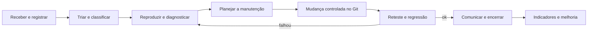

# 04 — Guia da SA 3: Operação e sustentação (Manutenção de Sistemas)

**Período:** encontros 13 a 15 — 02/11 a 04/11/2026 · **Estratégia:** projeto

## Desafio

Organizar o atendimento de suporte e realizar uma **manutenção controlada** no Sistema de Chamados.
A equipe deve interpretar e registrar a demanda, definir o tipo e o procedimento de manutenção, escolher
um método de correção ou atualização, executar a intervenção, verificar o resultado, comunicar o
atendimento e concluir os registros.

## Capacidades trabalhadas

- Reconhecer serviços de chamados para atendimento de suporte.
- Aplicar normas e procedimentos no atendimento ao usuário (netiqueta, ...).
- Registrar o atendimento de serviços para finalização do suporte.
- Identificar tipo, procedimento e plano de manutenção de sistemas.
- Identificar procedimento de registro de serviços de manutenção.
- Interpretar demanda de manutenção conforme suporte.
- Identificar métodos de correção e atualização do sistema.
- Definir método adequado para correção das falhas e atualização.
- Socioemocionais: princípios e procedimentos de análise de dados; tomada de decisão; espírito colaborativo.

## Cronograma

| Enc. | Data | Atividade | Evidência / entrega |
| --- | --- | --- | --- |
| 13 | 02/11 | Abertura e triagem de chamados; diagnóstico; tipos de manutenção. **AA1** (30%) e **avaliação objetiva**. | Chamados classificados e plano de manutenção. |
| 14 | 03/11 | Mudança controlada, correção/atualização, reteste e comunicação. **AA2** (60%) e **avaliação prática**. | Registro de mudança e chamado encerrado. |
| 15 | 04/11 | Simulação integrada, indicadores, apresentação, avaliação individual e feedback. | Dossiê, demonstração e reflexão individual. |

## Como as ocorrências chegam

O instrutor entrega **uma ocorrência por vez**: um **enunciado** (relato do usuário) e, quando for o caso,
uma **versão do sistema** para você instalar. Trate cada ocorrência como um chamado real de suporte:
o relato pode estar incompleto, e parte do trabalho é entender o problema antes de mexer no código.

## Fluxo de atendimento



### 1. Receber e registrar (enc. 13)

Abra um [registro de atendimento](08-modelos/registro-de-atendimento.md) assim que receber a ocorrência:
número, data/hora, quem relatou, descrição **nas palavras do usuário** e canal. Responda ao usuário
confirmando o recebimento (veja *Comunicação*).

### 2. Triar e classificar

- **Natureza**: falha (algo que deveria funcionar e não funciona), dúvida de uso, ou pedido de melhoria.
- **Tipo de manutenção**: **corretiva** (corrige falha), **preventiva** (evita falha futura, ex.: reforçar
  validação ou teste), **evolutiva** (nova funcionalidade ou melhoria pedida).
- **Prioridade** = impacto × urgência:

| Impacto \ Urgência | Alta | Média | Baixa |
| --- | --- | --- | --- |
| **Alto** (dados errados, segurança, muitos usuários) | Crítica | Alta | Média |
| **Médio** (função importante com contorno) | Alta | Média | Baixa |
| **Baixo** (cosmético, poucos usuários) | Média | Baixa | Baixa |

### 3. Reproduzir e diagnosticar

1. Reproduza com os **dados do seed** (`npm run db:reset`) e registre passos, esperado × obtido e evidência.
2. Compare com a [Especificação de requisitos](00-especificacao-de-requisitos.md): qual RF/RN é descumprido?
3. Localize a causa. Caminhos úteis:

| Sintoma em... | Onde olhar |
| --- | --- |
| Mensagem de campo / validação de formulário | `lib/validacao/esquemas.ts` |
| Ações e transições de status (o que a tela permite) | `lib/regras/chamados.ts`, `lib/regras/ordens.ts`, `app/(sistema)/**/acoes.ts` |
| Regras garantidas pelo banco, histórico | `supabase/migrations/*funcoes_e_gatilhos.sql` |
| Quem vê o quê | `supabase/migrations/*politicas_rls.sql` |
| Tela / texto / layout | `app/(sistema)/**/page.tsx`, `components/` |
| Mensagem de erro genérica | Terminal do `npm run dev` (erro técnico registrado pelo servidor) |

4. Escreva (ou descreva) um **teste que falha** demonstrando o defeito antes de corrigir.

### 4. Planejar a manutenção

No [registro de mudança](08-modelos/registro-de-mudanca.md): o que muda, por quê, arquivos afetados,
riscos, como testar, como desfazer e quem aprova. **Método de correção**: ajuste de código, nova migração
de banco, ajuste de dados, configuração ou documentação. Escolha o de menor risco que resolve a causa.

### 5. Mudança controlada no Git (enc. 14)

```bash
git status                                   # área de trabalho limpa?
git switch -c correcao/OC-XX-resumo          # ou melhoria/OC-XX-resumo
# ... altere o código e os testes ...
npm run lint && npm run typecheck && npm test
git add <arquivos>
git commit -m "fix(chamados): resumo da correção (OC-XX)"
```

Regras:

- **Uma mudança por branch**, commits pequenos e com mensagem clara (o quê e por quê).
- Mudou o banco? **Crie uma nova migração** — não edite migrações já aplicadas:
  `npx supabase migration new descricao_curta`, escreva o SQL, depois `npm run db:reset`,
  `npm run db:types` e `npm run db:test`.
- Mudou uma regra de transição? Ajuste `lib/regras/*.ts` **e** a função SQL correspondente.
- Ao final, integre na `main` (`git switch main && git merge --no-ff correcao/OC-XX-resumo`) e marque a
  versão (`git tag v1.0.1`).

### 6. Reteste e regressão

- **Reteste**: repita exatamente os passos de reprodução; registre o novo resultado e a evidência.
- **Regressão**: rode todas as suítes (`npm test`, `npm run db:test`, `npm run test:integration`,
  `npm run test:e2e`) e os casos manuais da área afetada. Anexe as saídas ao registro de mudança.

### 7. Comunicação e encerramento

Comunique-se de forma clara, cordial e objetiva (netiqueta): identifique-se, cite o número do atendimento,
diga o que foi feito e o que o usuário precisa fazer.

> *Olá, Eduardo. Sobre o atendimento AT-07 (texto do botão cortado na tela do celular): ajustamos o
> layout e a correção está na versão 1.0.1. Pode conferir no seu celular? Se estiver tudo certo,
> encerramos o atendimento. Obrigado pelo relato! — Equipe de suporte (Grupo 2)*

Encerre o registro de atendimento com: solução aplicada, versão, evidências do reteste, confirmação do usuário.

### 8. Indicadores e melhoria contínua (enc. 15)

Use os próprios registros (e os dados do sistema) para calcular, por exemplo:

| Indicador | Como calcular |
| --- | --- |
| Tempo até o primeiro atendimento | registro → início da triagem |
| Tempo total de atendimento | registro → encerramento |
| Taxa de reabertura | chamados reabertos ÷ chamados resolvidos |
| Resolução no primeiro atendimento | atendimentos sem reabertura ÷ total |
| Falhas por tipo/severidade | contagem a partir dos registros |

No sistema, o **histórico** de cada chamado traz as datas de cada mudança de status e a lista de chamados
pode ser filtrada por período. Feche com um ciclo **PDCA**: o que planejamos, o que fizemos, o que os
indicadores mostram e o que vamos mudar no processo.

## Entregas da SA 3

| Entrega | Modelo |
| --- | --- |
| Registro de atendimento (triagem, diagnóstico, comunicação, encerramento) | [registro-de-atendimento.md](08-modelos/registro-de-atendimento.md) |
| Registro de mudança (plano, execução, reteste, regressão) | [registro-de-mudanca.md](08-modelos/registro-de-mudanca.md) |
| Branch/commits da correção no Git | repositório da equipe |
| Indicadores e análise PDCA | livre |
| Dossiê e apresentação integrada (enc. 15) | reúne as entregas das SAs 1, 2 e 3 |

Critérios de avaliação: [09 — Critérios de avaliação](09-criterios-de-avaliacao.md).
