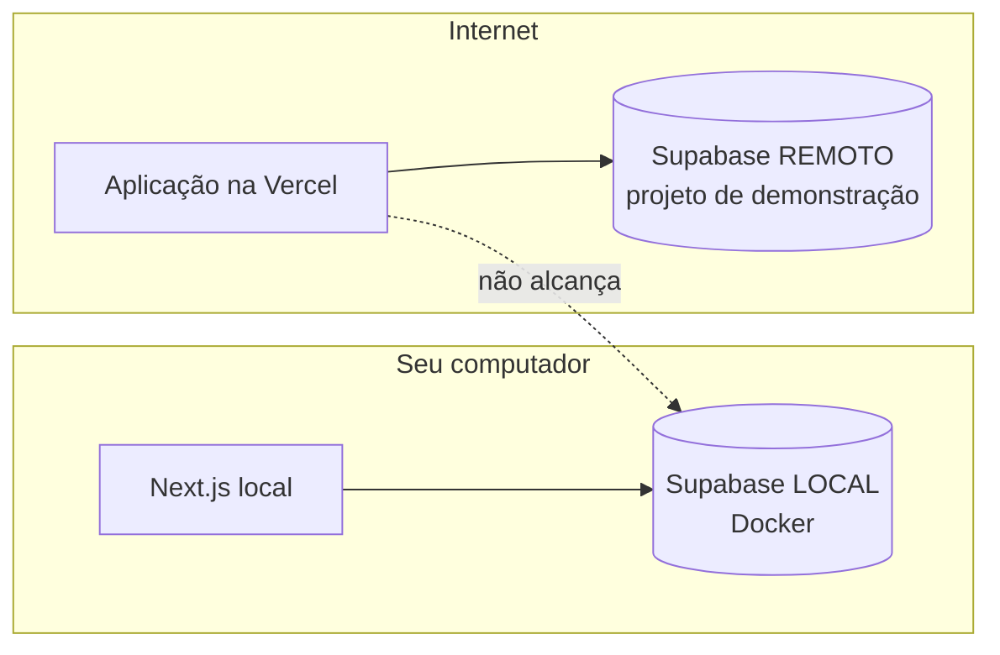

# 07 — Implantação demonstrativa (Vercel + Supabase remoto)

Como publicar uma **demonstração** do sistema na internet. Esta etapa é **opcional** e só deve ser feita
com autorização do instrutor, usando contas didáticas e **dados fictícios**.

## Antes de começar: por que um banco separado?



A aplicação publicada roda nos servidores da Vercel e **não consegue acessar** o Supabase que roda no
Docker do seu computador (`127.0.0.1` lá aponta para o próprio servidor da Vercel). Por isso a
demonstração usa um **projeto Supabase remoto, separado e só para demonstração**, com variáveis próprias.
Nenhum passo deste guia depende do Docker local.

| | Ambiente local | Demonstração remota |
| --- | --- | --- |
| Banco | Supabase no Docker do seu computador | Projeto Supabase de demonstração (nuvem) |
| Endereço da aplicação | `http://localhost:3000` | `https://<projeto>.vercel.app` |
| Variáveis | `.env.local` (criado pelo `setup:local`) | Painel da Vercel (*Environment Variables*) |
| Migrações | `npm run db:reset` / `setup:local` | `npx supabase db push` (projeto vinculado) |
| Dados | Seed com senhas conhecidas | **Sem o seed**: contas criadas na hora, senhas próprias |
| E-mail | Mailpit (nada sai do computador) | E-mails reais (envio limitado no plano gratuito) |

## Pré-requisitos

- Repositório do projeto em um serviço Git (GitHub, por exemplo) com acesso de leitura para a Vercel.
- Conta no Supabase (<https://supabase.com>) e na Vercel (<https://vercel.com>), de uso didático.
- O projeto passando em `npm run build` e nos testes no ambiente local.
- Node.js e dependências instalados (`npm ci`) para rodar a Supabase CLI.

## Passo 1 — Criar o projeto Supabase de demonstração

1. No painel do Supabase, **New project**. Nome sugerido: `chamados-demo-<turma-ou-equipe>`.
   Região: a mais próxima (ex.: *South America (São Paulo)*). Gere uma **senha do banco** forte e guarde-a
   em local seguro (gerenciador de senhas) — **nunca** no repositório.
2. Anote o **Project ref** (aparece na URL do painel: `.../project/<ref>`).
3. Em **Project Settings → API Keys**, copie a **Publishable key** (`sb_publishable_...`) e a
   **Project URL** (`https://<ref>.supabase.co`). **Não** copie a *secret key*: a aplicação não precisa dela.

## Passo 2 — Aplicar as migrações no projeto remoto

No terminal, na pasta do projeto:

```bash
npx supabase login                          # abre o navegador para autorizar a CLI
npx supabase link --project-ref <ref>       # pede a senha do banco do passo 1
npx supabase db push --dry-run              # MOSTRA o que seria aplicado (confira!)
npx supabase db push                        # aplica as migrações de supabase/migrations
```

- **Não** use `--include-seed` aqui: o seed cria usuários com a senha pública `Senha@123`, o que em uma URL
  pública permitiria que qualquer pessoa entrasse como administrador.
- O `link` cria arquivos em `supabase/.temp/` (ignorados pelo Git). Não versione senhas nem tokens.
- Para desfazer o vínculo depois: `npx supabase unlink`.

## Passo 3 — Configurar a autenticação remota

No painel do Supabase:

1. **Authentication → URL Configuration**:
   - *Site URL*: `https://<seu-projeto>.vercel.app` (ajuste depois do passo 4, quando souber a URL);
   - *Redirect URLs*: adicione `https://<seu-projeto>.vercel.app/auth/confirm`.
2. **Authentication → Emails → Confirm signup**: troque o link do modelo para o formato que a aplicação
   espera (o mesmo de `supabase/templates/confirmacao.html`):

   ```html
   <a href="{{ .SiteURL }}/auth/confirm?token_hash={{ .TokenHash }}&type=email&next=/painel">Confirmar meu e-mail</a>
   ```

3. Mantenha **Confirm email** ativado. O envio de e-mails do plano gratuito tem limite baixo por hora:
   para turmas, crie poucas contas ou configure um SMTP didático autorizado.

## Passo 4 — Criar o projeto na Vercel

1. **Add New → Project** e importe o repositório. A Vercel detecta **Next.js** automaticamente
   (comando de build `npm run build`).
2. Em **Environment Variables**, adicione para **Production** (e **Preview**, se for usar):

   | Nome | Valor |
   | --- | --- |
   | `NEXT_PUBLIC_SUPABASE_URL` | `https://<ref>.supabase.co` |
   | `NEXT_PUBLIC_SUPABASE_PUBLISHABLE_KEY` | `sb_publishable_...` do projeto de demonstração |

   Não adicione a chave secreta. Variáveis `NEXT_PUBLIC_*` são incorporadas no **build** e ficam visíveis
   no navegador — por isso só a chave publicável.
3. **Deploy**. Mudanças posteriores nas variáveis **só valem para novos deploys**: faça *Redeploy* depois de alterá-las.
4. Volte ao passo 3 e confirme a *Site URL* e a *Redirect URL* com o endereço final.

## Passo 5 — Criar as contas da demonstração

1. Acesse `https://<seu-projeto>.vercel.app/cadastrar` e crie as contas (ex.: uma de administrador, uma de
   técnico, uma de solicitante) com **senhas próprias**. Confirme pelos e-mails recebidos.
2. Promova o administrador no **SQL Editor** do painel do Supabase (executa como dono do banco):

   ```sql
   update public.perfis set papel = 'administrador'
   where id = (select id from auth.users where email = 'admin.demo@exemplo-da-turma.com');
   ```

3. Entre como administrador e defina os demais papéis pela tela **Usuários**.
4. Cadastre alguns equipamentos e chamados fictícios pela aplicação.

## Passo 6 — Validar a publicação

| # | Verificação | Esperado |
| --- | --- | --- |
| R1 | `https://<seu-projeto>.vercel.app/api/saude` | `"aplicacao":"ok","banco":"ok"` |
| R2 | Cadastro + confirmação por e-mail | Entra como Solicitante. |
| R3 | Solicitante tenta abrir `/usuarios` | Volta ao painel com aviso de permissão. |
| R4 | Fluxo chamado → ordem → resolução → encerramento | Histórico completo. |
| R5 | No painel da Vercel, *Deployments* | Deploy de Produção com status *Ready*. |

Registre data, URL, commit publicado e resultados no checklist.

## Reverter uma versão

- **Aplicação**: no painel da Vercel, em *Deployments*, use **Instant Rollback** para voltar ao deploy de
  produção anterior (ou `vercel rollback` na CLI da Vercel). Isso troca a versão em segundos, sem novo build.
  No plano gratuito, só é possível voltar para o deploy de produção imediatamente anterior. Depois de um
  rollback, novos pushes não são publicados automaticamente até você promover um deploy novamente.
- **Banco**: migrações **não são desfeitas** pelo rollback da aplicação. Por isso:
  1. antes de aplicar uma migração nova, faça backup: `npx supabase db dump --linked --data-only -f backups/demo.sql`
     (a pasta `backups/` não é versionada);
  2. prefira migrações que só **acrescentam** (novas colunas/tabelas), compatíveis com a versão anterior da aplicação;
  3. se precisar desfazer, crie uma **nova migração** que reverte a mudança e aplique com `db push`.

## Encerrar a demonstração

Ao fim do período: remova as contas, **pause ou exclua** o projeto Supabase de demonstração e o projeto da
Vercel, e revogue tokens criados (`npx supabase logout`).
