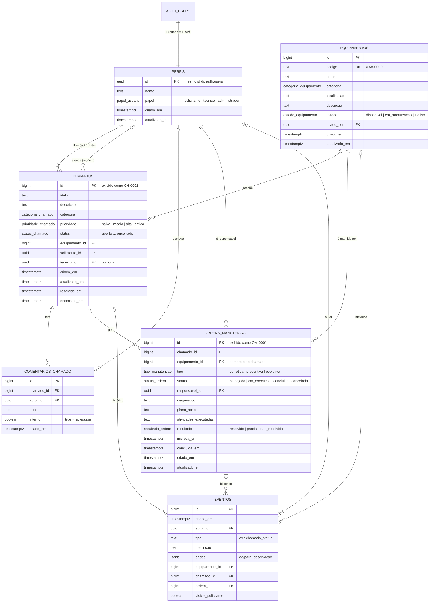

# 10 — Modelo de dados

O banco é um PostgreSQL gerenciado pelo Supabase. O esquema é criado **somente** pelas migrações em
`supabase/migrations/` (na ordem do nome do arquivo):

| Migração | Conteúdo |
| --- | --- |
| `..._tipos_e_tabelas.sql` | Tipos controlados (listas de valores), tabelas, chaves, restrições e índices. |
| `..._funcoes_e_gatilhos.sql` | Regras de negócio no banco, criação automática de perfil, histórico (auditoria). |
| `..._politicas_rls.sql` | Privilégios e políticas de segurança por linha (RLS). |

## Diagrama entidade-relacionamento

## Em linguagem simples

- **perfis** — cada pessoa cadastrada no Supabase Auth ganha automaticamente um perfil com **nome** e
  **papel** (começa como solicitante). O e-mail e a senha ficam só na área de autenticação (`auth.users`),
  separados dos dados da aplicação.
- **equipamentos** — o que a manutenção atende. O **código** é único. O **estado** diz se está disponível,
  em manutenção ou inativo.
- **chamados** — um pedido de atendimento sobre **um** equipamento, aberto por **um** solicitante e, depois
  da triagem, atendido por **um** técnico. O **status** só muda por transições permitidas.
- **comentarios_chamado** — conversa do chamado. Comentários **internos** só a equipe vê.
- **ordens_manutencao** — o serviço técnico executado para resolver um chamado. Um chamado pode ter várias
  ordens ao longo do tempo, mas **só uma ativa** por vez. Ordem concluída nunca apaga o chamado.
- **eventos** — o **histórico**: cada ação relevante vira uma linha com data, autor e descrição. É gravado
  por gatilhos do banco e ninguém pode alterá-lo pela aplicação.

## Restrições importantes

| Restrição | Onde | Garante |
| --- | --- | --- |
| `equipamentos_codigo_unico` / `equipamentos_codigo_formato` | equipamentos | Código único no formato `AAA-0000`. |
| `chamados_tecnico_obrigatorio` | chamados | Em atendimento, aguardando ou resolvido exige técnico. |
| `chamados_descricao_preenchida` | chamados | Descrição não pode ficar vazia. |
| `ordens_uma_ativa_por_chamado` (índice único parcial) | ordens | No máximo uma ordem planejada/em execução por chamado. |
| `ordens_conclusao_completa` | ordens | Ordem concluída tem diagnóstico, atividades, resultado e datas. |
| Chaves estrangeiras `ON DELETE RESTRICT` | chamados, ordens | Equipamento com chamados não pode ser excluído. |

## Regras no banco (gatilhos e funções)

| Função | Papel |
| --- | --- |
| `criar_perfil_novo_usuario` | Cria o perfil ao cadastrar; papel sempre `solicitante`. |
| `transicao_chamado_permitida` / `transicao_ordem_permitida` | Tabela de transições de status (RN-CH-01, RN-OM-01). |
| `validar_alteracao_chamado` / `validar_alteracao_ordem` | Aplicam as regras de status, campos imutáveis e permissões. |
| `alterar_status_chamado` / `alterar_status_ordem` | Mudança de status com observação (usadas pela aplicação). |
| `definir_papel` | Única forma de mudar papéis (só administrador; protege o último administrador). |
| `registrar_evento_*` | Gravam o histórico automaticamente. |
| `verificar_conexao` | Teste de fumaça (não lê tabelas). |

## Segurança por linha (RLS)

O RLS está **ativo em todas as tabelas**. Mesmo que alguém use a API do Supabase diretamente (sem passar
pelas telas), o banco só devolve e só aceita o que o papel permite:

| Tabela | Ler | Inserir | Alterar | Excluir |
| --- | --- | --- | --- | --- |
| perfis | todos autenticados | — (gatilho) | o próprio nome | — |
| equipamentos | todos autenticados | equipe | equipe | administrador |
| chamados | solicitante: os seus; equipe: todos | em nome próprio | equipe; solicitante só no próprio resolvido | — |
| comentarios_chamado | equipe: todos; solicitante: públicos dos seus | equipe; solicitante: públicos nos seus | — | — |
| ordens_manutencao | equipe; solicitante: as dos seus chamados | equipe | equipe | — |
| eventos | equipe: todos; solicitante: visíveis dos seus | — (gatilhos) | — | — |

"—" significa **negado para todos os usuários da aplicação**. Visitantes sem login não acessam nenhuma tabela.
